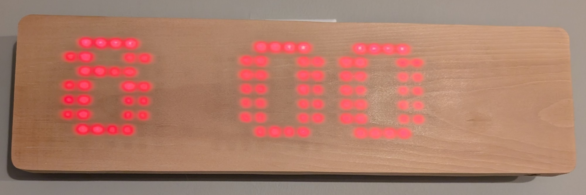
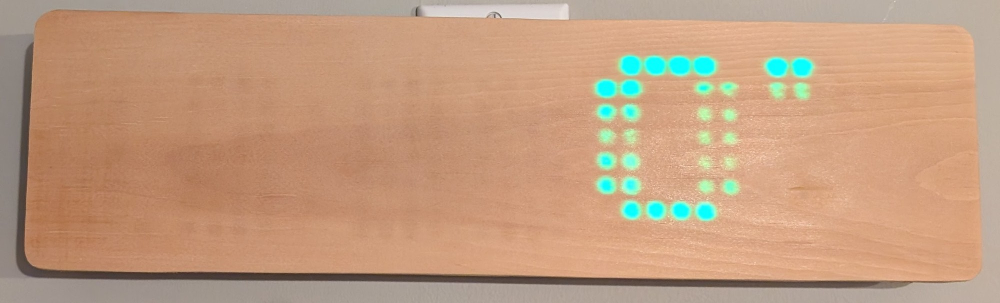
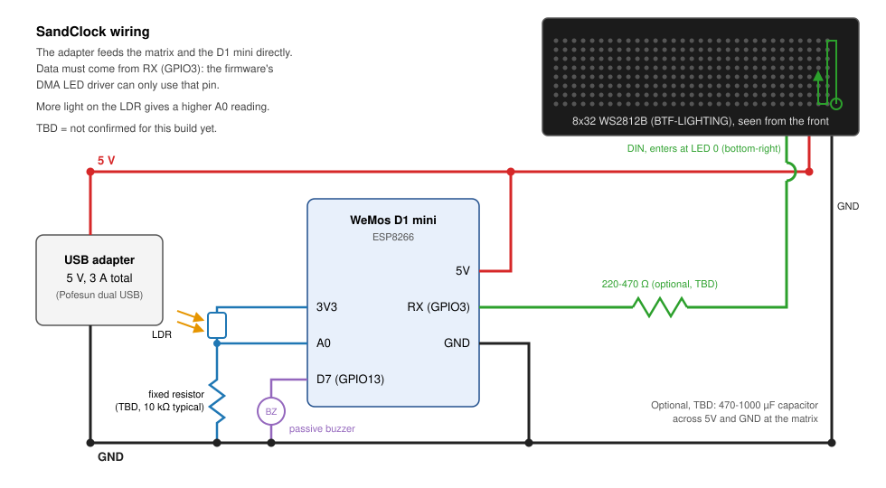

# Matrix Clock (SandClock)

Firmware and web UI for an ESP8266 (WeMos D1 mini) clock on a 32x8 WS2812B LED matrix. It started from the 7-Segment-Digital-Clock-V2 project; the hardware is now different, see [Hardware](#hardware).

<p>
  
  
</p>

- Time from NTP with POSIX timezone and DST rules, shown until synced as `--:--`
- Outdoor temperature from a Home Assistant sensor, with a cycle (time 5 s, temperature 2 s) or combined display. Without a reading (Home Assistant not set up, unreachable, or no good reading for 15 minutes) the clock leaves the temperature out and shows the time; the web UI says what is wrong
- The date (`THU 19`) in its own color: off, for 3 seconds once a minute at half past the minute, or for 2 seconds as a step in the cycle (time, temperature, date)
- Scrolling messages from the web UI, the HTTP API or Home Assistant, queued so back-to-back messages each get shown, with a live preview of how the text will scroll, how long it takes and which characters the clock can't draw
- Hourly and half-hourly chime, optionally muted when the light sensor says it is dark
- Automatic brightness from an LDR on `A0`
- Web UI at `http://sandclock.local` with live previews of the clock face, plus a device info panel
- Optional password, OTA updates, and settings that survive firmware and filesystem flashes
- Settings backup: download every setting as one file and restore it after a reflash or onto a new board
- Status in Home Assistant (light level, WiFi signal, problems, offline alerts) and messages from Home Assistant automations, from a ready-made package
- Diagnostics (WiFi name, IP address, firmware) scrolled on the clock after each boot, or on demand by covering the light sensor (or flashing a light at it) three times

## Hardware



Items marked **TBD** are not documented yet.

### Parts

| Part | Used here | Notes |
| --- | --- | --- |
| Controller | WeMos D1 mini (ESP8266, 4 MB flash) | `board = d1_mini` in `platformio.ini` |
| LED matrix | [BTF-LIGHTING WS2812B 8x32 panel](https://www.aliexpress.com/item/32944813367.html), 256 LEDs, 5 V | Flexible PCB. The firmware expects GRB colour order at 800 kHz, which is what WS2812B uses |
| Light sensor | Generic LDR plus a fixed resistor (**TBD** value; 10 kΩ is typical) | Divider on `A0` |
| Buzzer | Passive piezo buzzer | Driven with `tone()` on `D7` at 587 and 659 Hz. A passive buzzer is needed: an active one would only click or buzz at one pitch |
| Power | [Pofesun dual USB wall charger](https://www.amazon.ca/dp/B087FRRMQS), 5 V, 3 A total | The adapter feeds the matrix and the D1 mini's `5V` pin directly, so the LED current does not pass through the D1 mini |
| Body | Milled from a single piece of pine lumber, 380 × 100 mm, the LEDs shining through about 1 mm of pine | Design and milling notes in [`hardware/`](hardware/README.md). **TBD**: depths, milling parameters |

There is no real-time clock chip: the time comes from NTP. (The "RTC" in the code is the ESP8266's own RTC memory, used to count crashes for safe mode.)

### Pins

| D1 mini pin | GPIO | Connects to |
| --- | --- | --- |
| `RX` | GPIO3 | Matrix `DIN`. The firmware uses NeoPixelBus's DMA method (`Neo800KbpsMethod`), which on the ESP8266 can only output on this pin. Any other pin leaves the matrix dark |
| `A0` | ADC | Light sensor divider: LDR from `3V3` to `A0`, fixed resistor from `A0` to `GND`, so more light gives a higher reading. The D1 mini scales `A0`'s 0-3.2 V range to 0-1023 |
| `D7` | GPIO13 | Buzzer, other leg to `GND` |
| `5V` | | 5 V from the adapter, shared with the matrix |
| `GND` | | Common ground with the matrix and the adapter |

Data line extras (**TBD**: whether this build has them): a 220-470 Ω resistor in series with `DIN` near the matrix, and a 470-1000 µF capacitor across the matrix's 5 V and GND. Both are common good practice for WS2812B and cost nothing to add.

### Matrix orientation

Seen from the front, the data enters at the **bottom-right** LED. The chain runs up the rightmost column, down the next one to its left, and so on in a zig-zag, ending at the top-left or bottom-left (`ColumnMajorAlternating180Layout` in `src/vars.h`). A panel mounted the other way up shows everything upside down and mirrored. Change the layout in `src/vars.h` instead of rewiring.

### Power

A WS2812B LED draws up to about 20 mA per colour channel at full brightness, so about 60 mA for white. Most screens light far fewer than all 256:

| Screen | Most LEDs lit |
| --- | --- |
| Time (`10:08`) | 128 |
| Time and temperature combined | 84 |
| Date (`THU 19`) | 82 |
| Temperature | 72 |
| Scrolling message | about 100 |

With a single-channel colour (pure red, green or blue), even the time screen at full brightness needs about 2.6 A. The idle current of 256 LEDs and the D1 mini adds a few hundred mA. That fits a 3 A adapter, if only just. White, or any colour mixing all three channels, at full brightness would need about 7.7 A. Keep the brightness down for such colours, or leave auto brightness on: it runs from 15 to 230 of 255. The 3 A is the total for both of the adapter's ports, so don't charge a phone from the second one.

### Flashing over USB

The matrix's data line shares the `RX` pin with the USB serial port. A USB upload can briefly light random LEDs, which is harmless. If the upload fails to connect, unplug the matrix's data wire while flashing. After the first flash, use `tools/deploy.sh` (over WiFi), which avoids the issue. Serial logging still works, since it only uses `TX`.

## Build and flash

Needs [PlatformIO](https://platformio.org/).

```
cp src/secrets.h.example src/secrets.h   # WiFi used on first boot, before it is set in the web UI
pio run -t upload                        # firmware, over USB (first time only)
pio run -t uploadfs                      # web UI files, over USB (first time only)
```

After that, flash over WiFi with the deploy script. It builds, flashes the firmware and the filesystem image, waits for each reboot, then checks the running revision, that the UI is served, and that your settings did not change:

```
tools/deploy.sh                # firmware, then filesystem
tools/deploy.sh --fw           # firmware only
tools/deploy.sh --fs           # web UI only
tools/deploy.sh --dry-run      # read the clock, change nothing
CLOCK_PASSWORD='...' tools/deploy.sh   # if a password is set
```

`src/vars.h` has the semantic `FW_VERSION`. The exact commit (`git describe`, with `-dirty` for uncommitted changes) is embedded at build time and shown in `/info` and the Device info panel.

## Settings and persistence

Settings (WiFi, Home Assistant, colors, timezone, display, buzzer, password) live in the flash sector reserved for EEPROM, which sits after the filesystem. Flashing a firmware or filesystem image does not touch it. A full chip erase does, after which the clock starts with defaults and the WiFi credentials compiled in from `src/secrets.h`.

If the clock cannot join WiFi within 20 seconds of boot it opens a WPA2 access point named `SandClock` (web UI at `http://192.168.4.1`) while it keeps retrying your network every 30 seconds. The access point goes away once WiFi connects.

The access point password is random (10 characters, no look-alikes such as `0`/`O` or `1`/`I`), created the first time it is needed and stored with the other settings. While nobody has joined, the clock scrolls `AP PW <password>` across the matrix once a minute at a slow, readable pace. It is also shown in the web UI's Security card, where you can generate a new one. While a device is joined to the access point, the clock pauses its WiFi retries (one radio cannot serve both reliably), resuming about ten seconds after the last device leaves. Saving WiFi credentials from the setup page reboots the clock, which then tries the new network before opening the access point again.

Joining phones get a captive-portal redirect: unknown URLs are pointed at `http://192.168.4.1/`, so opening the setup page is usually automatic. `http://sandclock.local` also works while the access point is up.

### Backup and restore

The **Settings backup** card downloads every setting as `sandclock-settings.json` and restores one. Restoring replaces all settings and reboots the clock. A setting missing from the file gets its default, but secrets missing from it (or masked as `******`) keep their current values, so an incomplete file can't wipe your WiFi password.

The file holds the WiFi password, Home Assistant token, admin password and setup password in plain text, but only when an admin password is set (so downloading it needs that password). Without one, the file leaves the secrets out, because anyone on the network could download it. Keep a file with secrets somewhere private.

The file is checked before anything changes: it must be a SandClock settings file (the `/config` and `/info` replies are not), from this or an older firmware, with every text setting short enough to fit. Safe mode also offers the download, to save the settings before you reflash.

## Safe mode

A firmware that crashes while starting cannot be fixed over WiFi, because it never stays up long enough to receive an update. The clock counts crashed starts (exception or watchdog resets) in RTC memory. After three in a row it starts in safe mode: only WiFi (or the setup access point), a status page and OTA run. The matrix stays dark and the board's LED blinks fast. The status page at `http://sandclock.local/` shows the reset details; `/info` reports `safeMode`, `crashCount` and `resetInfo`.

Upload a working firmware (`tools/deploy.sh`, or the `/update` page) and the clock returns to normal. "Try a normal start" on the status page also resets the count. Two minutes of stable running clear the count, and a power cycle clears it too (RTC memory does not survive power loss).

A different failure mode is the clock running fine but its network stack wedged, which neither the watchdog nor safe mode catches. If the clock is unreachable and unsynced for 30 minutes it reboots itself.

To try it, crash the clock on purpose three times, waiting for each restart:

```
for i in 1 2 3; do curl -u admin:PASSWORD -X POST http://sandclock.local/debug/crash -d type=exception; sleep 25; done
```

`type=wdt` hangs the clock until the software watchdog resets it instead.

## Security

By default the web UI and API are open to anyone on your network. Set a password in the Security card to turn on HTTP Basic auth for every API call, the index page and the OTA page. The user name is always `admin`; the password is 8 to 31 characters. Setting or clearing it reboots the clock.

Basic auth over plain HTTP sends the password unencrypted and there is no brute-force throttling, so this keeps casual and accidental access out, not an attacker on your LAN.

If you forget the password, erase the flash over USB and set the clock up again (this also erases all other settings):

```
pio run -t erase
pio run -t upload && pio run -t uploadfs
```

## HTTP API

Use `curl -u admin:PASSWORD` when a password is set. POST bodies are form-encoded.

| Method | Path | Parameters |
| --- | --- | --- |
| GET | `/info` | Runtime status: network, time, NTP, Home Assistant, light, messages (`messageScrolling`, `messagesQueued`), memory, flash |
| GET | `/config` | Settings (the WiFi password and HA token are masked) |
| POST | `/config/clockcolor`, `/config/tempcolor`, `/config/othercolor`, `/config/datecolor` | `r`, `g`, `b` (0-255). `othercolor` is the scrolling message color, `datecolor` the date's (settings from before 2.18 start it at the message color) |
| POST | `/config/brightness` | `brightness` 0-255 |
| POST | `/config/autobrightness` | `autoBrightness` `true`/`false` |
| POST | `/config/hourformat` | `hourFormat` 12 or 24 |
| POST | `/config/displaystyle` | `displayStyle` 1 (cycle) or 2 (combined), and/or `dateMode` 0 (off), 1 (3 s once a minute) or 2 (2 s in the cycle; with the combined style, combined 5 s then date 2 s). The older `dateEnabled` `true`/`false` still works and means 1 or 0 |
| POST | `/config/chime` | any of `chimeEnabled`, `chimeMuteDark` (`true`/`false`), `chimeDarkThreshold` (0-1023) |
| POST | `/config/timezones` | `tzName`, `tzValue` (POSIX TZ string, for example `MDT6`) |
| POST | `/config/hassConfig` | `hassBaseUrl`, `hassEntityId`, `hassAT` |
| POST | `/config/wifiConfig` | `wifi_ssid`, `wifi_password` |
| GET | `/config/export` | Settings file to keep, with secrets in clear text when a password is set |
| POST | `/config/import` | Body: a settings file as JSON (`Content-Type: application/json`). Replaces all settings, then reboots |
| POST | `/config/auth` | `authPassword` (8-31 characters, empty turns auth off) |
| POST | `/config/ap` | Generate a new setup access point password |
| POST | `/debug/crash` | `type` `exception` or `wdt`: crash on purpose to test safe mode |
| POST | `/showmessage` | `messageText` (up to 127 bytes; letters show in upper case, digits and `- : . _` are drawn, anything else is a gap), optional `repeatCount` 1-100, `scrollDelay` 10-1000 ms per column. Queued behind a running message (up to 4 waiting; 503 when full), reply `{"result":"ok","queued":n}` |
| POST | `/sound` | `type` `single` or `double` |
| GET | `/syncTime` | Restart NTP and sync now |
| GET | `/reboot` | Restart |
| POST | `/forcetemp`, `/forcetime` | Debug: `forceTemp` degrees, `forceTime` epoch in milliseconds. SNTP puts the real time back |
| GET/POST | `/update` | OTA page. Upload field `firmware` or `filesystem` |

```
curl -u admin:PASSWORD -o sandclock-settings.json http://sandclock.local/config/export
curl -u admin:PASSWORD -H 'Content-Type: application/json' --data-binary @sandclock-settings.json \
     http://sandclock.local/config/import
```

```
curl -u admin:PASSWORD -X POST http://sandclock.local/showmessage \
     -d messageText="HELLO" -d repeatCount=2
```

## Buzzer and the light sensor

The chime can be switched off, and "mute when dark" silences all automatic beeps (the chime and the message start/end beeps) while the smoothed light reading is below the threshold. The Buzzer card shows the live sensor reading to help you pick the threshold; lower readings mean darker. The Sound buttons in the web UI always beep.

## Diagnostics on the clock

For when the web UI is out of reach (new network, unknown IP address), the clock can show its status on the matrix:

- **After every boot** it scrolls `WIFI <name>  IP <address>  FW <version>` once, quietly. Without WiFi it shows `NO WIFI <name>` and, while the setup access point is up, its name, password and address.
- **On demand**, cover the light sensor with your hand three times in a row, or in a dark room flash a light at it (a phone flashlight) three times. Each cover or flash and each gap should last about a quarter to one second, all within a few seconds. The clock beeps and scrolls the same details plus its uptime, and anything that needs attention (`HA ERR <code>`, `NO TIME`).

Both gestures are measured against the recent light level: a cover has to drop the reading below half, a flash has to at least double it. So covers work wherever there is some light (not below a level of 60), and flashes work in dim and dark rooms. Lights switching on or off, people walking past, headlights, a single shadow and lightning do not trigger them, and mixing covers and flashes in one sequence does not count. After a gesture the sensor is ignored for 10 seconds. `/info` reports `ldrNow` (the live 20 Hz reading) and `gestureBaseline` (the learned light level) for tuning.

## Home Assistant

The clock reads its outdoor temperature from Home Assistant (see the Temperature card). In the other direction, Home Assistant can show the clock's status: [docs/home-assistant/sandclock.yaml](docs/home-assistant/sandclock.yaml) is a ready-made package that polls `/info` every 30 seconds and creates:

| Entity | Meaning |
| --- | --- |
| `sensor.sandclock_light_level` | Room light from the LDR, 0 (dark) to 1023 (bright), smoothed over about 20 s |
| `sensor.sandclock_wifi_signal` | WiFi signal in dBm |
| `sensor.sandclock_uptime` | Seconds since the last boot |
| `sensor.sandclock_firmware` | Running firmware version |
| `binary_sensor.sandclock_temperature_fetch` | On when the temperature fetch from Home Assistant is failing |
| `binary_sensor.sandclock_time_sync` | On when the clock has no time from NTP |
| `binary_sensor.sandclock_safe_mode` | On when the clock is in safe mode |

Installation steps are at the top of the file: enable packages, copy the file, put in the clock's IP address (give the clock a DHCP reservation; `.local` names do not always resolve in Home Assistant) and add the clock's admin password to `secrets.yaml`. No firmware setting is involved.

When the clock stops answering, all of these turn `unavailable`. An offline alert, for example:

```yaml
automation:
  - alias: SandClock offline
    triggers:
      - trigger: state
        entity_id: sensor.sandclock_uptime
        to: unavailable
        for: "00:05:00"
    actions:
      - action: notify.notify
        data:
          message: The SandClock has not answered for 5 minutes.
```

### Messages from Home Assistant

The package also adds `script.sandclock_message` (and the `rest_command.sandclock_message` behind it), which scrolls text across the clock. Use it from any automation, or run it from the Scripts page to try it. It takes `message`, and optionally `repeat` (passes, default 1) and `delay` (ms per column, default 60). The clock draws letters (as capitals), digits and `- : . _`; anything else becomes a gap, so keep messages to those. Messages are up to 127 characters.

```yaml
automation:
  - alias: SandClock - washer done
    triggers:
      - trigger: numeric_state
        entity_id: sensor.washer_power
        below: 3
        for: "00:02:00"
    actions:
      - action: script.sandclock_message
        data:
          message: Washer done
          repeat: 2

  - alias: SandClock - door left open
    triggers:
      - trigger: state
        entity_id: binary_sensor.back_door
        to: "on"
        for: "00:10:00"
    actions:
      - action: script.sandclock_message
        data:
          message: Back door open

  - alias: SandClock - rain coming
    triggers:
      - trigger: state
        entity_id: weather.home
        to: rainy
    actions:
      - action: script.sandclock_message
        data:
          message: "Rain - {{ state_attr('weather.home', 'temperature') | round }} C"
```

The entity IDs are examples; use your own. The clock beeps before and after each message unless "mute when dark" is on and the room is dark. A message that arrives while another is scrolling waits its turn (up to 4 queued).

## Tools

| File | Purpose |
| --- | --- |
| `tools/deploy.sh` | Build, OTA flash, verify (see above) |
| `tools/render.py` | Terminal mock of the matrix using the real glyphs from `src/digits.h` and `src/scroll.h`, for example `python3 tools/render.py combined --time 14:08 --temp -4` or `python3 tools/render.py message --text HELLO --pos 4` or `python3 tools/render.py date --date 2026-11-19` |
| `tools/gen_fonts_js.py` | Regenerates `data/js/fonts.js` (used by the web UI previews) after editing `src/digits.h` or the message font in `src/scroll.h` |
| `tools/git_rev.py` | PlatformIO pre-build script that embeds `git describe` |

## Tests and CI

`tests/run.sh` runs the host-side checks: JavaScript and shell syntax, `fonts.js` matches `digits.h`, the web UI previews draw the same frames as `tools/render.py` (which mirrors `src/display.h`, and the message scroll and date screen in `src/scroll.h`), the Home Assistant reply parser (`src/ha_parse.h`) handles odd replies, the safe mode decision logic (`src/safe_mode_logic.h`), the light-sensor gesture (`src/light_gesture_logic.h`), the date screen layout (`src/date_screen_logic.h`), the order and timing of the time, temperature and date screens (`src/screen_cycle_logic.h`), and which settings files an import accepts (`src/config_import.h`). Run `pio run` once first so ArduinoJson is available. GitHub Actions (`.github/workflows/ci.yml`) builds both images and runs these checks on every push.

When you change a layout in `src/display.h`, update `tools/render.py` and `data/js/preview.js` too; the preview test fails if they drift.

## License

<a rel="license" href="http://creativecommons.org/licenses/by-nc-sa/4.0/"></a><br />This work is licensed under a <a rel="license" href="http://creativecommons.org/licenses/by-nc-sa/4.0/">Creative Commons Attribution-NonCommercial-ShareAlike 4.0 International License</a>.
