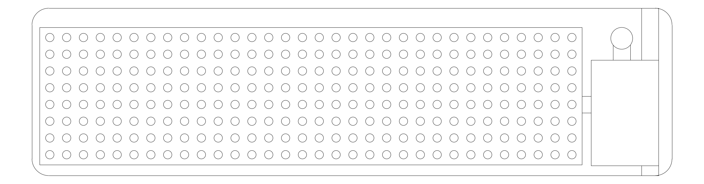

# SandClock body

The body is milled from a single piece of pine lumber. The design is an
Onshape sketch of the body's outline and pockets, exported as DXF.

- [`body-front.dxf`](body-front.dxf): the sketch, in millimetres, ready for CAM.
- [`body-front.png`](body-front.png): a preview of it.

Items marked **TBD** are not documented yet. The sketch is 2D, so it has no
depths.

## What the sketch shows

All sizes in mm, measured from the DXF.

| Feature | Size | Notes |
| --- | --- | --- |
| Outline | 380 × 100, 10 mm corner radius | |
| Matrix pocket | 322 × 82 | The 320 × 80 matrix plus 1 mm clearance on each side. The holes are centred in it |
| LED holes | 256 × Ø5, on a 10 mm grid (32 × 8) | One over each LED, matching the matrix's 10 mm pitch. Blind holes from the back, stopped about 1 mm short of the front, so each LED shines through a thin skin of pine |
| Electronics pocket | 40 × 63, right of the matrix | Holds the D1 mini, the buzzer and the wiring. Sits 5.4 mm from the matrix pocket, its bottom edge 0.5 mm below it |
| Wire channel | 5.4 wide × 10 long | Joins the matrix pocket to the electronics pocket, just below the centre line |
| Round pocket | Ø13, top right | Joined to the electronics pocket by a 10 mm channel. **TBD**: what it holds |
| Light sensor slot | 10 wide, from the electronics pocket to the top edge | Carries the wires to the light sensor, which sits at the top edge |
| Bottom slot | 10 wide, from the electronics pocket to the bottom edge | Was for a barrel jack, no longer used. Can be left out of a new build |

## Not in the sketch yet

| Item | Value |
| --- | --- |
| Stock (pine board) size and thickness | **TBD** |
| Depth of each pocket | **TBD** |
| Pine left over the LEDs | About 1 mm. This sets how bright and soft the LEDs look |
| Where the light sensor sees out | The top edge, at the end of the light sensor slot |
| Bits: types and diameters | **TBD** |
| Spindle speed, feed rate, depth per pass | **TBD** |
| Machine and CAM software | **TBD** |
| How the matrix and the electronics are held, and whether there is a back cover | **TBD** |
| Finish | **TBD** |

A STEP export of the Onshape part studio would record the depths, too.
